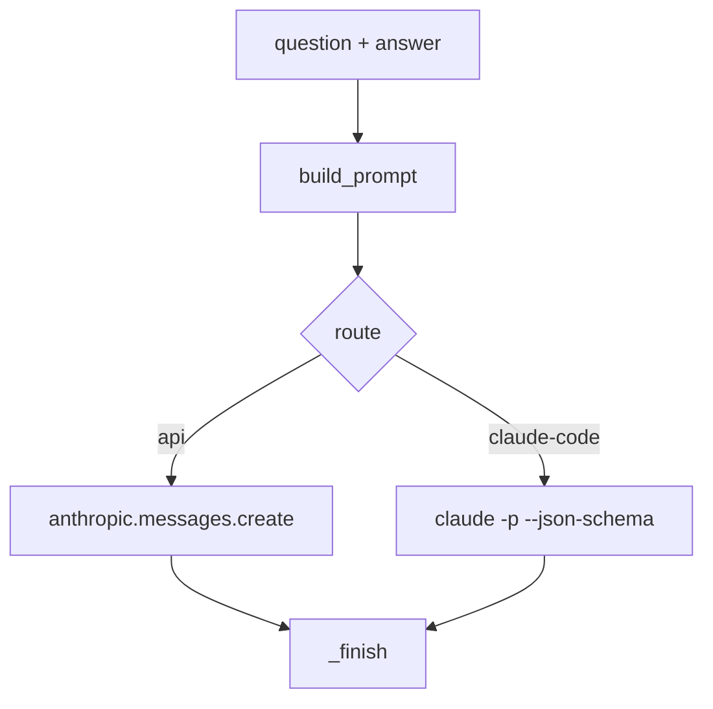

# Interview answer grader

## Intent
Grade a candidate's free-text answer to a theory interview question against a stored grid (reference answer, key
points, common mistakes) and return a structured verdict the app can display and store. It exists so that the
grading is reproducible, prompt-stable and independent of which model route the user has access to.

## Context
`server.py` calls `grade(question, answer)` on `POST /api/theory/answer` and `/api/theory/grade`, and `status()` on
startup and on `GET /api/theory/status`. Questions come from `bank/theory/*.json`; verdicts are stored by
`backend/store.py`. Settings come from `backend/config.py`, section `grader` (ungoverned frontier for now).

## Goals
- G1: one verdict schema whatever the route: `score` (0-10 integer), `covered`, `missing`, `wrong` (lists of strings),
  `feedback`, `improved_answer` (strings), plus `model` and `usage` metadata.
- G2: two routes with identical prompt and schema: Anthropic API (`api`) and Claude Code CLI (`claude-code`).
- G3: `auto` picks the API when a key is present, else Claude Code when logged in, else reports offline with a reason.
- G4: no credential is ever read from a file, written to a log or sent to the page.

## Non-Goals
- NG1: generating or editing grading grids (owned by the bank tools).
- NG2: storing verdicts (owned by `backend/store.py`).
- NG3: any provider other than Anthropic models.

## Assumptions
- A1: a question with a grid has 3 to 6 `key_points` and at least one `common_mistakes` entry (enforced by
  `tools.check_theory`).
- A2: the `claude` CLI, when used, supports `-p`, `--output-format json`, `--json-schema`, `--system-prompt`,
  `--tools ""`, `--setting-sources ""` and `auth status` printing JSON with `loggedIn`.
- A3: the `anthropic` SDK is installed only when the `api` route is wanted (optional extra `api`).

## Interface
Inputs:
- `question`: dict — bank item with `question`, `reference`, `key_points`, `common_mistakes`.
- `answer`: str — the candidate's text; empty or whitespace grades as "(empty)".

Outputs:
- `status(refresh=False)`: dict `{available: bool, backend: str, model: str, reason: str}`; cached, 60 s when
  unavailable.
- `grade(question, answer)`: dict with the G1 fields.

Errors:
- `GraderError`: no grid, route unavailable, provider refusal, truncated or unreadable output, CLI not logged in,
  timeout, network or API errors. The message is user-displayable English.

## Behavior
### Nominal
1. `status()` resolves the route from `config.grader.backend`.
2. `build_prompt()` lays out question, reference, key points, common mistakes and the answer in Markdown sections.
3. The route is called with the system prompt `SYSTEM`, the JSON schema `SCHEMA` and `effort` from the config.
4. `_finish()` clamps the score to 0-10, coerces lists and strings, attaches `model` and `usage`.

### Edge cases
- Score outside 0-10 or non-integer -> clamped, or `GraderError` if not coercible.
- Missing list or string fields in the model output -> empty values, never a crash.
- `claude-code` output not JSON at the start of stdout -> the first `{` onwards is parsed.

### Failure scenarios
- API `stop_reason == "refusal"` -> `GraderError("The model declined to grade this answer.")`.
- API `stop_reason == "max_tokens"` -> `GraderError` (truncated).
- CLI `is_error` mentioning login -> status cache refreshed, `GraderError` asking to run `claude` then `/login`.
- CLI exceeds `timeout_seconds` -> `GraderError` naming the timeout.

## Architecture Impact
- New / changed coupling, cycles, or shared state: none; `backend/config.py` is read at import time (frontier).

## Diagram

## Acceptance Criteria
- [ ] AC1: every route produces the G1 schema and clamps the score (`tests/test_grader.py`).
- [ ] AC2: `auto` ordering and offline reasons are as in G3 (`tests/test_grader.py`).
- [ ] AC3: the CLI is invoked with no tools, no project settings and the replaced system prompt
  (`tests/test_grader.py`).
- [ ] AC4: credentials are never written anywhere by the grader (`tests/test_grader.py`).

## Open Questions
