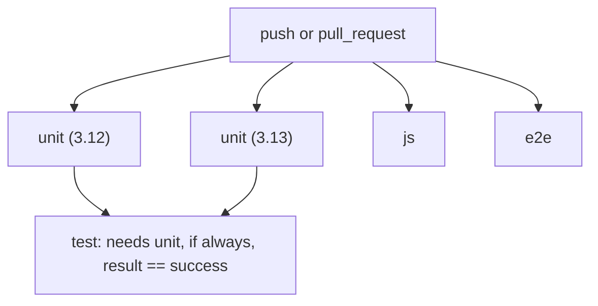

# Continuous integration and repository hygiene

## Intent
Run the project's checks on every pull request and every push to `main`, on both supported Python versions, with
every third-party action pinned to a commit, and give contributors the same checks before each commit. It exists so
that a regression, a drifting dependency or a tampered action tag is caught before it reaches `main`.

## Context
The checks themselves belong to other components: `ruff check .`, `python -m mypy .` and `python -m pytest -q`
(the Python code and its bank checkers), `npm run lint` (SP-WEB-QA) and `python -m pytest -q -m e2e tests/e2e`
(SP-WEB-QA). This component only orchestrates them: the GitHub Actions workflow `CI`
(`.github/workflows/ci.yml`), the Dependabot configuration (`.github/dependabot.yml`) and the pre-commit
configuration (`.pre-commit-config.yaml`), plus `tests/test_ci_config.py`, which reads the three files and checks
the properties below. `repoach.toml` waits on the check named `test`
(`auto_merge.required_checks`) and re-arms on the workflow named `CI` (`rearm_workflows`); branch protection on
`main` requires the checks `test`, `js` and `e2e`. Code-only: `resources: []`.

## Goals
- G1: the Python steps run on Python 3.12 and 3.13 with `fail-fast: false`, so one failing leg never hides the
  other's result.
- G2: exactly one check named `test` summarizes the matrix, so `repoach.toml` and branch protection keep a single
  stable name.
- G3: every `uses:` of the workflow and every hook repository of the pre-commit configuration is pinned to a full
  commit SHA, with the version tag in a trailing comment, so a moved tag cannot change what runs.
- G4: a superseded pull request run is cancelled, and no job runs without a time limit.
- G5: Dependabot proposes weekly updates for pip, npm and the actions, with minor and patch bumps grouped, never
  touches the pandas and numpy pins of the `check` extra, and moves the packages that must change together
  (`eslint` with `@eslint/js`, the GitHub Actions) in one pull request whatever the bump.
- G6: `pre-commit install` gives a contributor the linter, the type checker, ESLint and the file checks before each
  commit, with the project's own interpreter and `node_modules`.

## Non-Goals
- NG1: changing what the checks test; the commands are those of the Development section of the README.
- NG2: formatting the tree with `ruff format`: the tree is not formatted yet, so the pre-commit configuration runs
  the linter only.
- NG3: running the browser suite on more than one Python version or more than one browser.
- NG4: publishing anything; releases are a separate component.

## Assumptions
- A1: `ubuntu-latest` provides the pinned action versions' runtime and a Chromium-capable environment.
- A2: the `check` extra pins pandas and numpy to the Pyodide 0.27.7 versions (`pandas==2.2.3`, `numpy==2.0.2`),
  the ones the exercises run on in the browser (SP-PY-RUNTIME), and `.venv-check` mirrors them; numpy
  2.0.2 publishes no wheel for Python 3.13, so the 3.13 leg installs `pandas==2.2.3` with `numpy~=2.1.0`, the
  closest release that does.
- A3: the pre-commit tool is installed by the `dev` extra; contributors run it from `.venv-check`.

## Interface
Inputs:
- `push` to `main` and `pull_request` events: trigger the workflow `CI`.
- `.github/dependabot.yml`: read by GitHub on its weekly schedule.
- `.pre-commit-config.yaml`: read by `pre-commit install` and `pre-commit run --all-files`.

Outputs:
- Checks on a pull request: `unit (3.12)`, `unit (3.13)`, `test`, `js`, `e2e`; `test` is the one required by
  `repoach.toml` and branch protection.
- Dependabot pull requests with the commit prefix `build(deps)`.
- A git pre-commit hook that runs the configured checks on the staged files.

Errors:
- A failing, cancelled or skipped matrix leg fails `test` (`if: always()` on the aggregate job with a result check).
- A job exceeding its `timeout-minutes` (15 for a matrix leg, 5 for `test`, 10 for `js`, 30 for `e2e`) is
  cancelled and reported as failed.

## Behavior
### Nominal
1. A push or pull request starts `CI`; the concurrency group `CI-<ref>` cancels the run in progress for the same
   pull request ref and lets runs on `main` finish.
2. `unit` installs the project with pip on each Python version, then runs `ruff check .`, `python -m mypy .` and
   `python -m pytest -q`.
3. `test` depends on `unit`, runs even when a leg failed (`if: always()`), and exits 0 only when
   `needs.unit.result == 'success'`.
4. `js` runs `npm ci` and `npm run lint` on Node 22; `e2e` installs the `check`, `dev` and `e2e` extras, Chromium,
   and runs the browser suite on Python 3.12.
5. Locally, `pre-commit install` registers the hook; each commit runs end-of-file-fixer, trailing-whitespace,
   check-json, check-yaml, check-toml, `ruff check`, `.venv-check/bin/python -m mypy .` (when a Python file is
   staged) and `npm run lint` (when a file under `app/js`, `eslint.config.js` or a package file is staged).

### Edge cases
- Only one leg fails -> the other leg still finishes (`fail-fast: false`) and `test` fails.
- A pull request receives a second push while CI runs -> the first run is cancelled.
- A Dependabot update of an action -> the SHA and its trailing version comment are both updated by Dependabot.
- A new pandas or numpy release -> no Dependabot pull request: the `pip` entry ignores every version of both
  (`ignore` with `dependency-name` only), because the pins follow Pyodide, not PyPI.
- A new ESLint major -> `eslint` and `@eslint/js` arrive in the single `javascript` group pull request
  (`patterns: ["eslint*", "@eslint/*"]`, `update-types: [minor, patch, major]`); the other npm packages keep
  their minor-and-patch group, which excludes those patterns.
- A new major of one action -> every action update arrives in the single `actions` group pull request
  (`patterns: ["*"]`, `update-types: [minor, patch, major]`).

### Failure scenarios
- A pinned action SHA is unreachable -> the job fails at checkout, which is the intended behavior for a moved or
  deleted tag.
- A `pip` cache miss or a slow CDN during `e2e` -> the job runs longer but is bounded by its timeout.

## Architecture Impact
- Adds dependency: none (the workflow invokes commands, it imports no module).
- New / changed coupling, cycles, or shared state: the check name `test` is shared with `repoach.toml`
  (`auto_merge.required_checks`) and with the branch protection of `main`; renaming it requires changing both.

## Diagram

## Acceptance Criteria
This component is configuration read by GitHub and by pre-commit, not code the suite imports: the selectors below
parse the three files and check their shape; what they cannot see is named as observable on GitHub or in a shell.

- [ ] AC1: a pull request shows the checks `unit (3.12)`, `unit (3.13)`, `test`, `js` and `e2e` from the workflow
  `CI`, and `test` is green only when both `unit` legs are green (`gh pr checks <N>`); the shape is checked by
  `tests/test_ci_config.py::TestWorkflow::test_unit_matrix_runs_both_python_versions_without_fail_fast` and
  `tests/test_ci_config.py::TestWorkflow::test_the_required_check_test_aggregates_the_matrix`.
- [ ] AC2: every `uses:` line of `.github/workflows/ci.yml` is of the form `owner/repo@<40-hex-sha> # vX.Y.Z`
  (`tests/test_ci_config.py::TestWorkflow::test_every_action_is_pinned_to_a_commit_with_its_version_in_a_comment`)
  and no checkout persists its token
  (`tests/test_ci_config.py::TestWorkflow::test_checkout_never_persists_credentials`).
- [ ] AC3: the workflow is named `CI`, has a `concurrency` block and every job a `timeout-minutes` key
  (`tests/test_ci_config.py::TestWorkflow::test_workflow_is_named_ci_with_a_concurrency_group_and_a_timeout_on_every_job`).
- [ ] AC4: `.github/dependabot.yml` lists the ecosystems `pip`, `npm` and `github-actions` with a weekly schedule, a
  group covering minor and patch bumps each and the commit prefix `build(deps)`
  (`tests/test_ci_config.py::TestDependabot::test_three_ecosystems_weekly_with_grouped_minor_and_patch_updates`);
  GitHub's Dependabot tab shows the three.
- [ ] AC7: the `pip` entry groups minor and patch bumps and ignores every version of `pandas` and `numpy`
  (`tests/test_ci_config.py::TestDependabot::test_pip_groups_minor_and_patch_and_ignores_every_version_of_the_pyodide_pins`);
  the `npm` entry has a `javascript` group with the patterns `eslint*` and `@eslint/*` for minor, patch and major,
  and a minor-and-patch group excluding them
  (`tests/test_ci_config.py::TestDependabot::test_npm_moves_eslint_and_its_config_together_including_majors`);
  the `github-actions` entry has one `actions` group for minor, patch and major
  (`tests/test_ci_config.py::TestDependabot::test_actions_arrive_in_one_group_including_majors`).
- [ ] AC5: the pre-commit configuration pins its hook repositories to commits and declares the file checks,
  `ruff-check`, mypy and eslint
  (`tests/test_ci_config.py::TestPreCommit::test_hook_repositories_are_pinned_to_commits_and_the_hooks_mirror_ci`);
  `pre-commit run --all-files` from `.venv-check` passes on the tree after this change.
- [ ] AC6: `gh api repos/jwfaye/sparring/branches/main/protection` reports `required_status_checks.strict == true`
  with the contexts `test`, `js` and `e2e`, `enforce_admins.enabled == false`, `required_linear_history.enabled ==
  true`, `allow_force_pushes.enabled == false`, `allow_deletions.enabled == false`, and no required reviews.

## Open Questions
