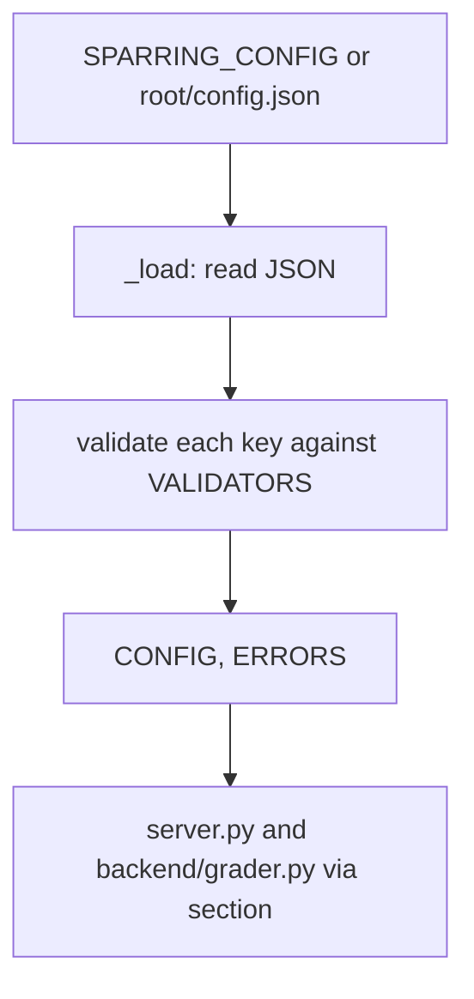

# Application settings

## Intent
Load the application settings once, at import, from one JSON file merged over built-in defaults, and validate every
value so that a typo never prevents the server from starting. It exists so that the server and the grader read their
options from a single place, with the API key kept out of it.

## Context
`backend/config.py` is imported by `server.py` (section `server`) and `backend/grader.py` (section `grader`) through
`section(name)`. It reads `config.json` at the project root, or the file named by the `SPARRING_CONFIG` environment
variable when it is set, which is how the browser tests run a server on a free port with the grader forced offline
without touching the repository's `config.json`. The module imports nothing from the project, hence `depends_on: []`.
Code-only: `resources: []`.

## Goals
- G1: every key of `DEFAULTS` is validated; an invalid value keeps its default and adds one message to `ERRORS`.
- G2: a missing file is not an error; an unreadable file, a non-object document, an unknown section or key is
  reported in `ERRORS` and the rest still applies.
- G3: `SPARRING_CONFIG` overrides the path of the settings file; unset or empty, the path is `<root>/config.json`.
- G4: only the API key (`ANTHROPIC_API_KEY`), `SPARRING_CONFIG` and `SPARRING_LOG_LEVEL` live in the environment;
  every other option lives in the file.

## Non-Goals
- NG1: reloading the file while the server runs: it is read once at import.
- NG2: reading option values from the environment or the command line (`server.py [port]` is the one exception,
  handled by the server).
- NG3: merging several files.

## Assumptions
- A1: the file, when present, is UTF-8 JSON.
- A2: callers only read `CONFIG`, `ERRORS` and `section()`; they do not mutate the sections.

## Interface
Inputs:
- `SPARRING_CONFIG`: environment variable, optional — path of the settings file; unset or empty means
  `<root>/config.json`.
- the settings file: a JSON object with the sections `server` (`host`: non-empty string; `port`: integer from 1 to
  65535) and `grader` (`backend`: `auto` | `api` | `claude-code` | `offline`, case-insensitive; `model`: non-empty
  string; `effort`: `low` | `medium` | `high`, case-insensitive; `claude_bin`: non-empty string; `timeout_seconds`:
  integer >= 1). Every section and key is optional.

Outputs:
- `settings_path() -> str`: the path resolved from the environment, computed again on every call.
- `PATH: str`: the path resolved at import, the one `CONFIG` was loaded from.
- `_load(path: str) -> tuple[Config, list[str]]`: a fresh copy of `DEFAULTS` merged with the valid values of the
  file at `path`, and the list of messages.
- `CONFIG: Config`, `ERRORS: list[str]`: the result of `_load(PATH)` at import.
- `section(name: str) -> Section`: `CONFIG[name]`.

Errors:
- none raised: every problem becomes a message in `ERRORS`; the server logs them as warnings at startup.

## Behavior
### Nominal
1. `settings_path()` returns `SPARRING_CONFIG` when set and non-empty, else `os.path.join(ROOT, "config.json")`.
2. `_load(path)` copies `DEFAULTS` section by section, reads the JSON file, then for each known section and key runs
   the validator: a valid value replaces the default (strings are stripped, choices are lowercased), an invalid one
   is reported with the value received and the default kept.
3. `CONFIG, ERRORS = _load(PATH)` runs at import; `section(name)` returns the live dictionary of a section.

### Edge cases
- Missing file -> defaults, `ERRORS == []`.
- Empty section (`{"server": {}}`) -> defaults for that section, no message.
- Booleans are rejected where an integer is expected (`True` is not a valid port).
- `host` and the choice values are stripped; `backend` and `effort` are lowercased.
- The messages name `config.json` whatever the path loaded: the file name is not interpolated.

### Failure scenarios
- Invalid JSON -> defaults and one message `config.json is unreadable (...)`.
- A JSON document that is not an object -> defaults and one message.
- A section that is not an object, an unknown section or an unknown key -> one message each; valid values of the
  other sections and keys still apply.

## Architecture Impact
- New / changed coupling, cycles, or shared state: none; `CONFIG` is module state read by the importers.

## Diagram

## Acceptance Criteria
- [ ] AC1: a missing file yields the defaults with no message
  (`tests/test_config.py::test_defaults_when_file_is_missing`).
- [ ] AC2: a complete valid file replaces every default and a partial file keeps the other defaults
  (`tests/test_config.py::test_valid_file_overrides_defaults`,
  `tests/test_config.py::test_partial_file_keeps_other_defaults`).
- [ ] AC3: an unreadable file, a non-object document, an unknown section or key and every invalid value is reported
  with the default kept, and every message is collected
  (`tests/test_config.py::test_invalid_json_uses_defaults`, `tests/test_config.py::test_unknown_key_is_reported`,
  `tests/test_config.py::test_invalid_port_keeps_default`,
  `tests/test_config.py::test_every_error_is_collected_and_valid_values_still_apply`).
- [ ] AC4: `SPARRING_CONFIG` set to an existing file loads that file
  (`tests/test_config.py::test_env_override_loads_the_given_file`).
- [ ] AC5: `SPARRING_CONFIG` set to a missing file keeps the defaults with no message
  (`tests/test_config.py::test_env_override_missing_file_keeps_defaults`).
- [ ] AC6: `SPARRING_CONFIG` unset or empty resolves to `<root>/config.json`
  (`tests/test_config.py::test_unset_env_uses_the_default_path`,
  `tests/test_config.py::test_empty_env_uses_the_default_path`).
- [ ] AC7: the shipped `config.json` loads without a message (`tests/test_config.py::test_shipped_config_is_valid`).

## Open Questions
