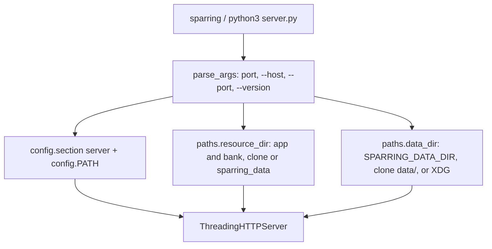

# Installable sparring command

## Intent
Make Sparring installable with `pipx install git+https://github.com/jwfaye/sparring` (or `pip install .`) so that a
`sparring` command serves the app from any directory, while a clone keeps working with `python3 server.py`. It exists
so that using the app no longer requires a checkout, and so that an installed copy keeps the user's answers and
settings in per-user directories instead of inside `site-packages`.

## Context
`server.py` is the only entry point: it serves `app/` and merges `bank/*/*.json`, both found next to its own file,
and `backend/store.py` writes answers under `data/` at the same root. Packaging ships `app/` and `bank/` inside the
wheel as the `sparring_data` package (`pyproject.toml` maps `sparring_data.app` to `app/` and `sparring_data.bank`
to `bank/`, so the repository layout does not change and `tools/`, `tests/` and the e2e suite keep their paths), and
`backend/paths.py` resolves the shipped directories and the data directory at runtime. The settings file lookup
lives in `backend/config.py` (SP-CONFIG 0.2): `SPARRING_CONFIG`, else `./config.json`, else the per-user file. The
command line is `argparse` in `server.py`, exposed as `[project.scripts] sparring = "server:main"`; `python -m
server` works as well since `server.py` is a shipped module. `server.py` itself has no owning spec (a frontier
file, as `backend/store.py`): this component owns the entry point declaration in `pyproject.toml`, the resolution
module and the tests of the command line. Code-only: `resources: []`.

## Goals
- G1: `pip install .` (and the pipx form) installs a `sparring` command that serves `/`, `/api/health` and the full
  banks from any current directory, with no file read from the repository.
- G2: the wheel ships `app/` and `bank/` under `sparring_data/` and nothing from `data/`, `tests/`, `node_modules/`
  or `tools/sources/`.
- G3: a clone keeps its behavior: `python3 server.py [port]` from the root reads `./config.json`, serves the
  `app/` and `bank/` next to `server.py` and writes answers under `data/theory/`.
- G4: once installed, answers go to `$XDG_DATA_HOME/sparring` (`~/.local/share/sparring`), `SPARRING_DATA_DIR`
  overriding it everywhere, and the settings come from `~/.config/sparring/config.json` unless `SPARRING_CONFIG` or a
  `./config.json` is present.
- G5: `sparring [port] [--host HOST] [--port PORT] [--version] [--help]`: the positional port stays; `--version`
  prints the version from the package metadata, `unknown` without metadata.
- G6: the server logs the settings file and the data directory in use at startup, one line each.

## Non-Goals
- NG1: moving `app/`, `bank/` or `tools/` in the repository: the layout of a clone is unchanged.
- NG2: making `tools/` work on an installed copy: they are development tools, run from the root of a clone with
  `python -m tools.<name>`, and keep reading and writing `bank/` there.
- NG3: publishing on PyPI, building an sdist deliberately, or supporting a zipped installation (`zipimport`): pip
  and pipx unpack wheels on disk, which `importlib.resources` resolves to a real directory.
- NG4: migrating existing answers from `data/` of a clone to the per-user directory.
- NG5: Windows and macOS paths beyond their platform default (`%LOCALAPPDATA%`, `~/Library/Application Support`).

## Assumptions
- A1: the package is installed unpacked (pip, pipx, uv tool), so `importlib.resources.files("sparring_data")` is a
  `pathlib.Path`.
- A2: `server.py` is imported as the top-level module `server` both from a clone (root on `sys.path`) and once
  installed (`py-modules = ["server"]`).
- A3: `backend/config.py` resolves the settings file by the SP-CONFIG 0.2 order and exposes `PATH`.

## Interface
Inputs:
- `sparring [port] [--host HOST] [--port PORT] [--version] [--help]`: `port` and `--port` are integers from 1 to
  65535 and must agree when both are given; `--host` is an address to bind. Unset values come from the settings
  file, section `server`.
- `SPARRING_DATA_DIR`: environment variable, optional — the data directory; unset or empty means `<root>/data` in a
  clone, else the per-user data directory.
- `XDG_DATA_HOME`: environment variable, optional — base of the per-user data directory; unset or empty means
  `~/.local/share` on Linux, `~/Library/Application Support` on macOS, `%LOCALAPPDATA%` on Windows.

Outputs:
- `backend.paths.ROOT: str`: the directory holding `server.py`.
- `backend.paths.is_clone() -> bool`: `ROOT/app` and `ROOT/bank` both exist.
- `backend.paths.resource_dir(name: str) -> str`: `ROOT/<name>` in a clone, else the directory `<name>` of the
  installed `sparring_data` package.
- `backend.paths.user_data_home() -> str`, `backend.paths.data_dir() -> str`: the per-user base and the data
  directory resolved as above.
- `server.parse_args(argv: list[str] | None) -> argparse.Namespace` with `host: str | None`, `port: int | None`.
- `server.version() -> str`: `importlib.metadata.version("sparring")`, or `unknown`.
- `server.main(argv: list[str] | None = None) -> None`: the console script.
- `store.DATA`: `<data_dir()>/theory`, computed at import.

Errors:
- `FileNotFoundError` from `resource_dir()` when the directory exists neither next to `server.py` nor in the
  package: the server does not start.
- `SystemExit(2)` from `parse_args()` on an invalid or disagreeing port, as `argparse` does.

## Behavior
### Nominal
1. `sparring` parses its arguments, reads `config.section("server")`, binds `--host` or the settings host on
   `--port`, the positional port or the settings port, logs `Settings: <path>` (with `(not found, using defaults)`
   when the file is missing) and `Data directory: <dir>`, then serves as before.
2. `APP_DIR` and `BANK_DIR` in `server.py` are `paths.resource_dir("app")` and `paths.resource_dir("bank")`; the
   `_file` tag of a bank item is relative to the parent of `BANK_DIR` (`bank/<kind>/<file>.json` in both layouts).
3. `store.DATA` is `<data_dir()>/theory`; profiles nest under it as before.

### Edge cases
- Editable install (`pip install -e .`) -> `ROOT` is the clone, `is_clone()` is true, nothing is read from
  `sparring_data`.
- `SPARRING_DATA_DIR` set in a clone -> it wins over `<root>/data`.
- `--version` from a bare clone without metadata -> `unknown`.
- Positional port and `--port` equal -> accepted; different -> exit 2 with a message.

### Failure scenarios
- `sparring_data` missing from the installation and no clone -> `FileNotFoundError` at import of `server`.
- Port already in use -> `OSError` from the socket bind, as before.

## Architecture Impact
- Adds dependency: SP-PACKAGING -> SP-CONFIG (the command reads `config.section("server")` and logs `config.PATH`;
  the lookup order of the settings file, changed for the installed case, is specified in SP-CONFIG 0.2).
- New / changed coupling, cycles, or shared state: `backend/store.py` (unowned) now imports `backend.paths` for its
  data directory; `backend/config.py` keeps importing nothing from the project, so there is no cycle.

## Diagram

## Acceptance Criteria
- [ ] AC1: the positional port, `--port`, `--host`, an invalid port and a disagreeing pair behave as specified
  (`tests/test_cli.py::test_positional_port_is_kept_for_compatibility`, `tests/test_cli.py::test_port_option`,
  `tests/test_cli.py::test_host_option`, `tests/test_cli.py::test_invalid_port_is_refused`,
  `tests/test_cli.py::test_positional_and_option_must_not_disagree`,
  `tests/test_cli.py::test_main_uses_the_arguments_over_the_settings`,
  `tests/test_cli.py::test_main_falls_back_to_the_settings`).
- [ ] AC1b: the server logs the settings file, with a caveat when it is missing, and the data directory at startup
  (`tests/test_cli.py::test_main_logs_settings_and_data_directory`,
  `tests/test_cli.py::test_main_logs_an_existing_settings_file_without_a_caveat`).
- [ ] AC2: `--version` prints the package metadata version and `unknown` without metadata; `--help` lists every
  option (`tests/test_cli.py::test_version_prints_the_package_version`,
  `tests/test_cli.py::test_version_comes_from_the_package_metadata`,
  `tests/test_cli.py::test_version_is_unknown_without_metadata`, `tests/test_cli.py::test_help_lists_every_option`).
- [ ] AC3: in a clone the shipped directories are those next to `server.py`; installed, those of `sparring_data`;
  missing everywhere is an error (`tests/test_paths.py::test_clone_uses_the_directories_next_to_server_py`,
  `tests/test_paths.py::test_installed_layout_uses_the_data_package`,
  `tests/test_paths.py::test_packaged_dir_missing_subdirectory_falls_through_to_error`,
  `tests/test_paths.py::test_packaged_dir_ignores_a_resource_that_is_not_a_directory_on_disk`,
  `tests/test_paths.py::test_missing_everywhere_is_an_error`).
- [ ] AC4: the data directory is `SPARRING_DATA_DIR`, else `<root>/data` in a clone, else the per-user directory,
  and the store writes there (`tests/test_paths.py::test_data_dir_env_override_wins`,
  `tests/test_paths.py::test_data_dir_in_a_clone_is_data_at_the_root`,
  `tests/test_paths.py::test_data_dir_when_installed_is_the_user_data_directory`,
  `tests/test_paths.py::test_user_data_home_without_xdg_is_under_home`,
  `tests/test_paths.py::test_user_data_home_on_macos_and_windows`,
  `tests/test_store.py::test_data_dir_override_moves_the_answers`,
  `tests/test_store.py::test_default_data_dir_is_under_the_clone`).
- [ ] AC5: the settings file lookup order is the one of SP-CONFIG 0.2 (its AC6 and AC8, `tests/test_config.py`).
- [ ] AC6: the bank merge and the HTTP API are unchanged (`tests/test_server.py`), the shipped banks still pass
  their checkers (`tests/test_banks.py`), and the browser suite still starts `server.py` from the root
  (`tests/e2e/`).
- [ ] AC7: manual, recorded in the pull request: the wheel built with `python -m pip wheel . --no-deps` lists
  `server.py`, `backend/`, `sparring_data/app/`, `sparring_data/bank/` and `tools/` and nothing from `data/`,
  `tests/` or `tools/sources/`; installed in a throwaway venv, `sparring --version` prints the version and
  `sparring --port <free port>` run from a directory outside the repository serves `/api/health`, `/api/exercises`
  with every exercise and the index page.

## Open Questions
