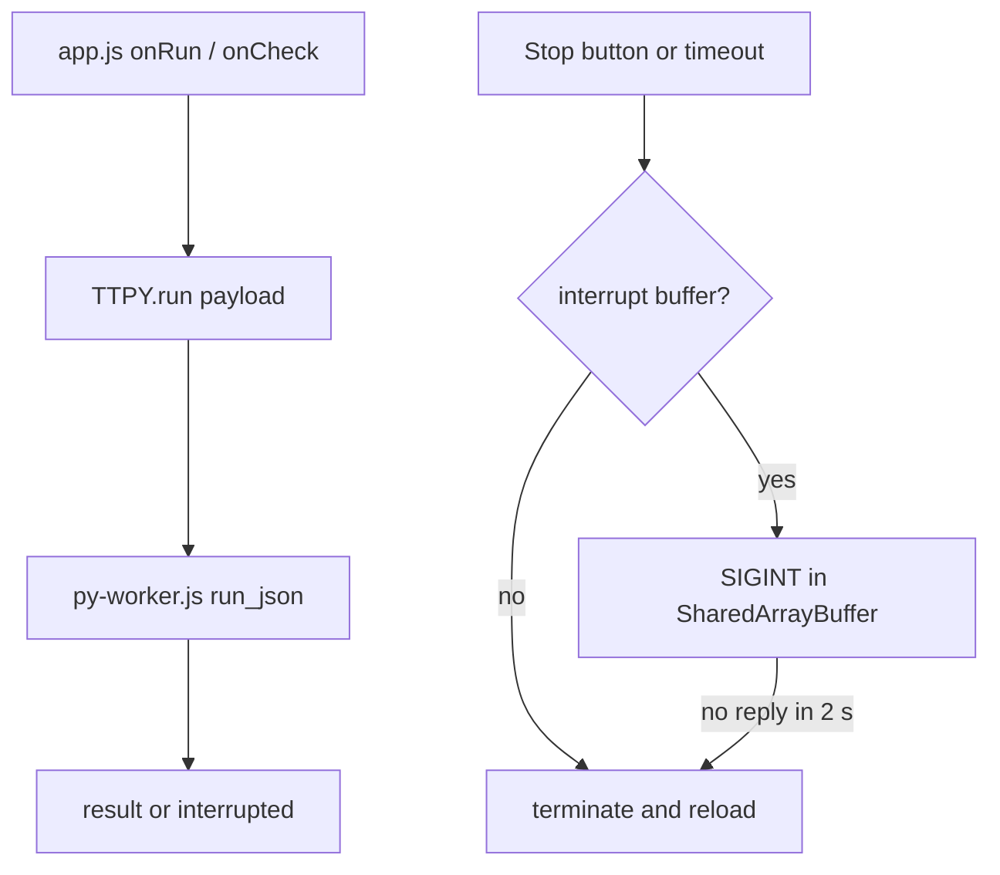

# Pyodide worker runtime

## Intent
Run the exercise code (Python via Pyodide, SQL via its sqlite3) in a dedicated Web Worker instead of the page's main
thread, so that an infinite loop or a long computation never freezes the tab and can always be stopped: by the user
(Stop button) or by a hard timeout. It exists because the exam setting makes runaway code likely and a frozen tab
loses the candidate's unsaved work.

## Context
`app/js/app.js` (shared file: only its runtime section, the `initPython` / `runPy` / Stop wiring, follows this spec;
the rest stays frontier) calls the client `window.TTPY` from `app/js/py-client.js`. The client spawns
`app/js/py-worker.js`, a classic worker that `importScripts` Pyodide 0.27.7 from the pinned jsdelivr URL, loads
and imports numpy, pandas and sqlite3, runs `app/py/harness.py` once and then answers run requests with
`run_json(payload)`.
`server.py` (frontier) serves the worker file with the same Content-Security-Policy as the page and, for this spec,
the two cross-origin isolation headers that unlock `SharedArrayBuffer`. The component is code-only: `resources: []`.

## Goals
- G1: the page's main thread never executes user code; the editor, timers and tabs stay responsive during a run.
- G2: a run can be interrupted at any time by the Stop button and is interrupted automatically after
  `run_timeout_ms` (20 s); the next run works without reloading the page.
- G3: when the page is cross-origin isolated, the interruption is cooperative (Pyodide's interrupt buffer raises
  `KeyboardInterrupt` inside the user code); otherwise the worker is terminated and Python reloaded.
- G4: the output area shows one clear line `Execution interrupted after N s` on every interruption, and the status
  pill in the top bar tells when Python is loading, ready, restarting or unavailable.
- G5: every public behavior of the exercise tab is unchanged: Ctrl+Enter / Ctrl+Shift+Enter, result rendering,
  attempts and status saved in progress.

## Non-Goals
- NG1: vendoring Pyodide or working offline (SECURITY.md describes how to vendor the assets).
- NG2: interrupting native code that never returns to the Python eval loop (a never-ending SQLite query): the
  terminate-and-reload fallback covers it after `interrupt_grace_ms`.
- NG3: streaming partial output during a run; the harness still buffers stdout and returns it at the end.
- NG4: the quiz and interview tabs, which do not execute code.

## Assumptions
- A1: the browser supports classic Web Workers and WebAssembly (every browser Pyodide 0.27 supports).
- A2: jsdelivr, cdnjs and Google Fonts answer with `Cross-Origin-Resource-Policy: cross-origin` (verified on
  2026-11-03), so `Cross-Origin-Embedder-Policy: require-corp` does not block any resource of `app/index.html`.
- A3: `SharedArrayBuffer` exists only when `crossOriginIsolated` is true; the client treats its absence as the
  "no interrupt buffer" case, never as an error.
- A4: `app/py/harness.py` catches `Exception` only, so a `KeyboardInterrupt` raised by the interrupt buffer escapes
  `run_json` and reaches the worker as a `PythonError` of type `KeyboardInterrupt`.

## Interface
Worker protocol (`postMessage`, structured clone):

Inputs (page to worker):
- `{id: number, action: "init", interruptBuffer: Uint8Array | null}`: load Pyodide, the packages and the harness;
  install the interrupt buffer when one is given (a view on a `SharedArrayBuffer`).
- `{id: number, action: "run", payload: object}`: `payload` is the harness payload (`mode`, `language`, `setup`,
  `code`, `tests`, `run_call`).

Outputs (worker to page):
- `{id, status: string}`: progress text while an `init` is in flight.
- `{id, ok: true, result: object}`: the harness JSON (`run` mode: `{output, error}`; `check` mode: `{ok, tests}`);
  for `init`, `result` is `{ready: true}`.
- `{id, ok: false, error: string, interrupted: boolean}`: the Python or load error; `interrupted` is true when the
  error is a `KeyboardInterrupt`.

Client (`window.TTPY`, used by `app/js/app.js`):
- `init(onStatus)`: `Promise<void>`; `onStatus(text, cls)` receives the same status texts as the top-bar pill
  (`cls` in `loading | ok | err`).
- `isReady()`: boolean.
- `isRunning()`: boolean.
- `run(payload)`: `Promise<object>`; resolves with the harness result, or with
  `{interrupted: true, error: "Execution interrupted after N s ...", output: "", ok: false, tests: []}`.
- `stop()`: request the interruption of the current run; no-op when nothing runs.
- `RUN_TIMEOUT_MS` (20000) and `INTERRUPT_GRACE_MS` (2000): constants, exposed for tests.

Server (`server.py`): every response carries `Cross-Origin-Opener-Policy: same-origin` and
`Cross-Origin-Embedder-Policy: require-corp` in addition to the existing headers.

Errors:
- `run()` rejects with `Error("Python is not ready")` when called before `init` resolved or while Python restarts.
- `run()` rejects with the load error when the worker fails to start (CDN unreachable, CSP block).

## Behavior
### Nominal
1. `init`: the client allocates `new Uint8Array(new SharedArrayBuffer(1))` when `crossOriginIsolated` is true,
   spawns the worker, posts `init`; progress texts are relayed to the status pill; on `ok` the pill says
   "Python ready" and `isReady()` becomes true.
2. `run`: the client assigns an id, records the start time, arms the timeout (`run_timeout_ms`), posts `run`,
   enables Stop. On the worker's reply it clears the timers, disables Stop and resolves.
3. Stop or timeout: `stop()` is called with the reason. With an interrupt buffer, the client writes `2` (SIGINT) in
   it and arms `interrupt_grace_ms`; Pyodide raises `KeyboardInterrupt` in the user code, the worker replies
   `interrupted: true`, the promise resolves with the interruption result. Without a buffer, the client goes
   straight to restart.
4. Restart: `worker.terminate()`, the pending run resolves with the interruption result (suffix "Python was
   restarted"), the pill shows "Restarting Python..." and a fresh worker is initialized; the next run waits for it.
5. `app.js` renders the interruption result through its existing error path: run mode shows the line in the output
   area; check mode shows it, counts the attempt and marks the exercise failed.

### Edge cases
- The code finishes between the interrupt request and the worker's reply -> the normal result is returned and the
  buffer is reset to 0 so that the next run is not interrupted by a stale signal.
- The user code catches `KeyboardInterrupt` (bare `except:`) -> the grace timer expires and the worker is restarted.
- The interrupt lands inside an `import` -> the worker drops from `sys.modules` every module imported since init,
  so the half-initialized module is imported again from scratch on the next run (numpy, pandas and sqlite3 are
  imported at init, before any user run, so they are never in that situation).
- Stop pressed while nothing runs -> no-op; the button is disabled outside a run.
- `run()` called while Python restarts -> the page shows "Python is still loading" (the existing message).
- Page not cross-origin isolated (another server, headers stripped by a proxy) -> same user experience, every
  interruption restarts Python (about 1 s with the browser cache) and the pill says so.

### Failure scenarios
- Pyodide or a package fails to load -> the pill shows "Python unavailable: <reason>" in red; `run()` rejects.
- The worker crashes (`onerror`) -> the pending run rejects with the error and the worker is restarted.
- The harness raises outside user code -> the existing "Harness internal error" result is returned unchanged.

## Architecture Impact
- New / changed coupling, cycles, or shared state: `app/js/app.js` (frontier) now depends on `window.TTPY` instead
  of a global `loadPyodide`; `server.py` (frontier) gains two response headers. No new edge between governed specs.

## Diagram

## Acceptance Criteria
- [ ] AC1: every server response carries `Cross-Origin-Opener-Policy: same-origin`
  (`tests/test_server.py::test_coop_header_is_same_origin`).
- [ ] AC2: every server response carries `Cross-Origin-Embedder-Policy: require-corp`, on API and static responses
  alike (`tests/test_server.py::test_coep_header_is_require_corp`).
- [ ] AC3: the harness still produces the documented run and check results (`tests/test_harness.py`); it is loaded
  unchanged by the worker and by the bank checkers.
- [ ] AC4: in the browser, `crossOriginIsolated` is true and the console shows no CSP or COEP error after the page
  and Python load. No automated test yet: manual check with the browser console on
  `http://127.0.0.1:<port>/?profile=test`.
- [ ] AC5: in the browser, `while True: pass` is interrupted by the Stop button and, without pressing anything,
  after 20 s; both show `Execution interrupted after N s` in the output area and the next Run of a normal exercise
  works without reloading the page. No automated test yet: manual check in the exercise tab.
- [ ] AC6: in the browser, Run and Check of a shipped exercise behave as before (output shown, tests listed,
  attempt counted) and Ctrl+Enter / Ctrl+Shift+Enter still trigger them. No automated test yet: manual check.

## Open Questions
