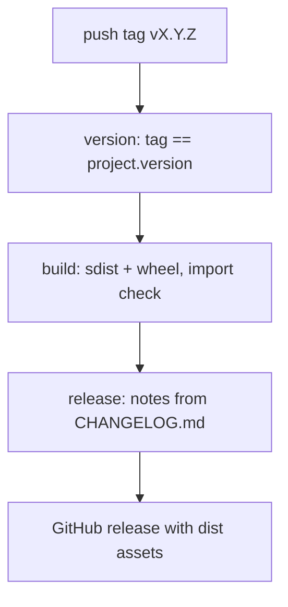

# Release process

## Intent
Turn a pushed tag `vX.Y.Z` into a GitHub release that carries the matching changelog section as notes and the built
sdist and wheel as assets, and write down the conventions a contribution must follow to get there. It exists so
that a release is a mechanical, reproducible step instead of a hand-written page.

## Context
The repository has a `pyproject.toml` with `project.version` (owned by the packaging component), a CI workflow
(`.github/workflows/ci.yml`, owned by the repository hygiene component) and specs under `docs/specs/`. This
component adds three process files and nothing else: `CHANGELOG.md` (Keep a Changelog 1.1.0, Semantic Versioning),
`CONTRIBUTING.md` (setup pointer, branch and commit conventions, spec-first workflow, changelog rule, license note)
and `.github/workflows/release.yml` (tag-triggered build and release). The README gets a `## Contributing` section
that links the two documents and states the release procedure. No Python or JavaScript code changes; the component
is code-only in the sense of the template (`resources: []`), its artifacts being process files.

## Goals
- G1: `CHANGELOG.md` lists every user-visible change merged so far, one line per change with the pull request number
  in parentheses (the short hash `faf5bbd` for the initial commit, which predates the first pull request), grouped
  under Added / Changed / Fixed / Security, with comparison links at the bottom.
- G2: pushing a tag `vX.Y.Z` builds the sdist and the wheel from the tagged tree, checks that the wheel installs and
  that `server` and `backend` import from it, and publishes a GitHub release named after the tag with the
  `## [X.Y.Z]` changelog section as notes and the dist files attached.
- G3: the workflow fails before building when the tag does not equal `project.version` in `pyproject.toml`, and
  before publishing when `CHANGELOG.md` has no section for that version.
- G4: every action is pinned to a full commit SHA with its version in a trailing comment, and `contents: write` is
  granted to the release job only.
- G5: `CONTRIBUTING.md` is short, factual, and does not duplicate the README's commands.

## Non-Goals
- NG1: publishing to PyPI; the workflow carries a comment on how to add it.
- NG2: creating the tag or the first release: the maintainer tags once the version is bumped and the changelog
  section is dated.
- NG3: editing `pyproject.toml` (packaging component) or `ci.yml` (hygiene component).
- NG4: enforcing the changelog rule or the commit conventions with a check; they are reviewed by hand and by repoach.

## Assumptions
- A1: `project.version` in `pyproject.toml` is the single source of the version; the tag is `v` followed by it.
- A2: `python -m build` with the setuptools backend produces exactly one sdist and one wheel in `dist/`.
- A3: the default `GITHUB_TOKEN` with `contents: write` may create a release and upload its assets on this
  repository.
- A4: `CHANGELOG.md` keeps the heading form `## [X.Y.Z] - YYYY-MM-DD` and the link references `[X.Y.Z]: <url>` at the
  end of the file; the notes extraction depends on both.

## Interface
Inputs:
- a pushed git tag matching `v*`, for example `v0.1.0`.
- `pyproject.toml`: `project.version`, read with `tomllib`, never written.
- `CHANGELOG.md`: the section whose heading starts with `## [X.Y.Z]`, where `X.Y.Z` is the tag without its `v`.

Outputs:
- a GitHub release with the tag as name, the changelog section (heading excluded) as body, and the files of
  `dist/` as assets.
- a workflow artifact `dist` carrying the sdist and the wheel between the build and release jobs.

Errors:
- version mismatch: the `version` job exits 1 with `tag vX.Y.Z does not match project.version A.B.C in
  pyproject.toml`.
- missing section: the `release` job exits 1 with `CHANGELOG.md has no section '## [X.Y.Z]'` before any release is
  created.
- wheel not importable: the `build` job fails on `python -c "import server, backend"` run outside the source tree.

## Behavior
### Nominal
1. Job `version`: check out the tag, compare `${GITHUB_REF_NAME#v}` with `project.version`; stop on mismatch.
2. Job `build` (needs `version`): `pip install build==1.6.1` (pinned like the actions), `python -m build`,
   `pip install dist/*.whl`, then from a directory outside the checkout `python -c "import server, backend"`;
   upload `dist/` as the artifact `dist`.
3. Job `release` (needs `build`, `contents: write`): check out the tag, extract the changelog section with awk
   (print the lines after the matching `## [` heading up to the next `## ` heading or the first `[...]: ` link
   reference), fail if the result is blank, download `dist`, create the release with the notes as body and
   `dist/*` as assets.

### Edge cases
- A tag on a commit whose `pyproject.toml` still carries the previous version -> the `version` job fails; bump the
  version, move the tag or push a new one.
- A changelog section present but empty -> the extraction yields only blank lines and the `release` job fails.
- A tag that is not `vX.Y.Z` (for example `v0.1.0-rc1`) -> the workflow runs; the version check then requires
  `project.version` to be `0.1.0-rc1` and the changelog a `## [0.1.0-rc1]` section.

### Failure scenarios
- `actions/upload-artifact` finds no file in `dist/` -> `if-no-files-found: error` fails the build job.
- `softprops/action-gh-release` matches no file for `dist/*` -> `fail_on_unmatched_files: true` fails the release
  job instead of publishing a release without assets.
- The release already exists for the tag -> the action updates its body and assets (default behavior of the action).

## Architecture Impact
- New / changed coupling, cycles, or shared state: none. The workflow reads `pyproject.toml` and `CHANGELOG.md`
  and imports the installed `server` and `backend` modules; no spec edge is introduced because nothing imports
  this component and it imports nothing at the code level.

## Diagram

## Acceptance Criteria
No pytest selector applies to this component: it owns process files only and runs on GitHub Actions on a tag push.
Each criterion names the manual check that verifies it.

- [ ] AC1: `CHANGELOG.md` has a `## [Unreleased]` section, a dated `## [0.1.0] - 2026-11-03` section grouped under
  Added / Changed / Fixed / Security with, on every line, the pull request number in parentheses or `(faf5bbd)` for
  the initial commit, and the `[Unreleased]` and `[0.1.0]` link references at the end. Check: read the file.
- [ ] AC2: the notes extraction, run locally with the awk program of the `release` job and `version=0.1.0` against
  `CHANGELOG.md`, prints the 0.1.0 section without its heading and without the link references; run with
  `version=9.9.9` it prints nothing and the blank-output test exits 1.
- [ ] AC3: the version check command of the `version` job,
  `python -c 'import tomllib; print(tomllib.load(open("pyproject.toml", "rb"))["project"]["version"])'`, prints
  `0.1.0`, equal to the upcoming tag `v0.1.0` without its `v`.
- [ ] AC4: `.github/workflows/release.yml` parses as YAML (`python3 -c "import yaml; yaml.safe_load(open(...))"` or
  `actionlint` when available), every `uses:` names a 40-character commit SHA followed by a `# vX.Y.Z` comment,
  the top-level permissions are `contents: read` and `contents: write` appears in the `release` job only.
- [ ] AC5: `CONTRIBUTING.md` points to the README Development section for setup without repeating its commands,
  states the branch and commit conventions, the spec-first workflow with the two repoach commands, the changelog
  rule and the license note; the README `## Contributing` section links `CONTRIBUTING.md` and `CHANGELOG.md` and
  gives the three-step release procedure.
- [ ] AC6: `ruff check .` and `.venv-check/bin/python -m pytest -q` still pass on the branch (no code is touched).

## Open Questions
