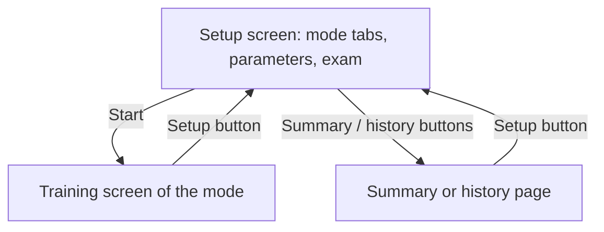

# Session setup screen and distraction-free training screens

## Intent
Open the page on a setup screen where the user picks a mode and its parameters once, then train on a screen that
shows only what the work needs. It exists because the configuration was scattered over the page (filters in the
exercise sidebar, an exam box in the top bar, a quiz form and an interview form on their tabs) and stayed in sight
while working.

## Context
The page keeps its four views (`#view-exercises`, `#view-qcm`, `#view-theory`, `#view-recap`) and their panels,
and gains `#view-setup`. The WAI-ARIA tab list moves from the top bar to the setup screen: three tabs
(`data-mode` = `exercises`, `qcm`, `theory`) control the panels `#setup-exercises`, `#setup-qcm` and
`#setup-theory`, which hold the existing controls with their ids (`#f-theme`, `#f-difficulty`, `#f-language`,
`#reshuffle`; `#qcm-themes`, `#qcm-n`, `#qcm-prioritize`, `#qcm-review`; `#th-status`, `#th-sections`,
`#th-only-new`, `#th-timer`). An exam panel (`#exam-enabled`, `#exam-minutes`, `#exam-toggle`) and one Start
button (`#btn-start`) follow, then quiet buttons to the Summary (`#btn-recap`), the quiz history
(`#btn-qcm-history`, the `#qcm-home` section reduced to its history) and the interview history (`#btn-th-history`,
`#th-home`). The top bar keeps the brand, a mode label (`#mode-label`), the exam clock (`#exam-clock`, shown only
while a countdown runs), the Python status (hidden in the quiz and interview modes), a Setup button (`#btn-setup`,
hidden on the setup screen) and the theme toggle.

This component promotes the frontier files it reworks into the governed regime: `app/js/app.js` (view switching,
setup state, start flow, exam countdown, exercises, summary; exposes `window.TTAPP.switchView`), `app/js/qcm.js`
(`window.TTQCM.start/openHistory/leave`), `app/js/theory.js` (`window.TTTHEORY.start/openHistory/leave`) and
`app/css/style.css`. Shared files touched: `app/index.html` (SP-WEB-ASSETS, its third-party tags untouched),
`app/js/common.js` (frontier: `selectTab` keys the tabs on `data-mode`), `tests/e2e/` (SP-WEB-QA: `conftest.py`
gains the `start` and `setup_screen` fixtures, the flows go through the setup screen, `test_setup.py` is new),
`tests/e2e/test_a11y.py` (SP-A11Y: the audit covers nine screens and the tab test targets the setup tab list,
function names unchanged), `README.md` and `docs/img/` (SP-BRAND: sections and screenshots). The runtime
(`window.TTPY`, SP-PY-RUNTIME) is called as before. Code-only: `resources: []`.

## Goals
- G1: the page opens on the setup screen; the last used setup (mode, exercise filters, exam checkbox and duration,
  quiz and interview preferences) is remembered per profile in `localStorage` under the `TT.NS` namespace, so a
  returning user presses Start.
- G2: Start begins the chosen mode with the parameters of its panel, and starts the exam countdown when the
  checkbox is ticked and none runs; a selection with no exercise or question keeps the setup screen with a message.
- G3: the training screens hold no configuration control: no select, checkbox, chip or option panel in the top
  bar or in the visible view; the exam clock appears only while a countdown runs.
- G4: the Setup button of the top bar returns to the setup screen from any training screen; the Summary and the two
  history pages open from the setup screen only.
- G5: keyboard behavior is kept (Ctrl+Enter and Ctrl+Shift+Enter in the editor, keys 1-4 and Enter in the quiz,
  Ctrl+Enter in the answer box, Escape then Tab out of the editor) and the tab list keeps the WAI-ARIA pattern with
  arrow keys; axe finds no serious or critical violation on any screen in either theme.

## Non-Goals
- NG1: a rewrite of the three modules: the existing functions are kept and re-wired.
- NG2: a multi-mode session (exercises then quiz on one Start): one mode per session, Setup to change.
- NG3: persisting the quiz or interview session across a reload (unchanged).
- NG4: a mobile layout.

## Assumptions
- A1: `localStorage` is available; when it is not, the setup falls back to its defaults (the helpers of
  `common.js` swallow storage errors).
- A2: the mode modules are loaded after `app.js`, so `window.TTAPP` exists when they wire their buttons, and
  `window.TTQCM` / `window.TTTHEORY` exist when Start is pressed (the page is interactive only after every script).

## Interface
Inputs:
- `localStorage[NS + 'setup']`: `{mode: 'exercises' | 'qcm' | 'theory', filters: {theme, difficulty, language},
  examEnabled: boolean}`; `NS + 'settings'.examMinutes`: integer minutes; `NS + 'qcm.prefs'` and
  `NS + 'theory.prefs'` as before.
- Controls: see Context.

Outputs:
- `window.TTAPP.switchView(view)`: shows one of `setup`, `exercises`, `qcm`, `theory`, `recap`; sets
  `body[data-view]`, the mode label and the Setup button.
- `window.TTQCM.start()` -> boolean (false: no question, message in `#qcm-msg`); `openHistory()`; `leave()`.
- `window.TTTHEORY.start()` -> boolean (false: message in `#th-msg`); `openHistory()`; `leave()`.

Errors:
- A bank that fails to load leaves a message in the mode's setup panel; Start on that mode does nothing.

## Behavior
### Nominal
1. Load: restore the setup record, apply the filters to the selects, select the remembered mode tab, show
   `#view-setup`, then load Pyodide (the status pill stays visible on the setup screen and in the exercises).
2. Start, exercises: the order is restored when the filters did not change (sessionStorage key), else rebuilt; the
   last exercise seen is resumed; `#view-exercises` is shown with the list, the statement and the editor.
3. Start, quiz: `newSession` reads the panel, saves the preferences and shows `#qcm-quiz` inside `#view-qcm`.
4. Start, interview: `pickQuestion` reads the panel, saves the preferences and shows `#th-question`.
5. Exam: the checkbox and the duration are shown when no countdown runs; while one runs, the panel shows the time
   left and a Stop button, the top bar shows the clock, and the banner appears when the time is over.
6. Setup button: saves the editor code, drops a running quiz session or stops the interview timer, shows the setup
   screen and focuses the selected mode tab.

### Edge cases
- Reshuffle on the setup screen -> the order of the undone exercises is redrawn and the next Start begins at its
  first exercise.
- An answer reopened from the interview history -> Back returns to the history page, not to the setup screen.
- The quiz end screen -> "Replay the missed ones" stays in the view, "Back to setup" leaves it.
- A Summary row click -> the filters are widened when the exercise is not in the current order, then the exercises
  screen opens on it.

### Failure scenarios
- `/api/qcm` or `/api/theory/*` unreachable -> the panel shows the error, Start on that mode returns false.

## Architecture Impact
- Adds dependency: SP-SETUP -> SP-WEB-ASSETS (the setup markup lives in `app/index.html`).
- Adds dependency: SP-SETUP -> SP-WEB-QA (the e2e fixtures and flows go through the setup screen).
- Adds dependency: SP-SETUP -> SP-A11Y (the tab list the audit checks moved to the setup screen).
- Adds dependency: SP-SETUP -> SP-PY-RUNTIME (`app.js` drives `window.TTPY` as before).
- Adds dependency: SP-SETUP -> SP-BRAND (README sections and screenshots describe the new flow).
- New / changed coupling, cycles, or shared state: `qcm.js` and `theory.js` call `window.TTAPP.switchView` to
  leave their views; `app.js` calls their `start`, `openHistory` and `leave`. No cycle at load time: the global
  objects are read when a button is pressed.

## Diagram

## Acceptance Criteria
- [ ] AC1: the page opens on the setup screen with the training views hidden, and after a reload the mode, the
  exercise filter, the quiz options and the exam duration are the ones last used
  (`tests/e2e/test_setup.py::test_page_opens_on_the_setup_screen_and_remembers_the_last_setup`).
- [ ] AC2: on each training screen no select, input, chip or tab list is visible in the top bar or the view, the
  exam clock is hidden, and the Setup button returns to the setup screen
  (`tests/e2e/test_setup.py::test_training_screens_show_no_configuration_controls`).
- [ ] AC3: the exam clock is visible only while a countdown runs, and the setup screen shows the running state with
  a Stop button (`tests/e2e/test_setup.py::test_exam_countdown_shows_the_clock_only_when_set`).
- [ ] AC4: the Summary, the quiz history and the interview history open from the setup screen
  (`tests/e2e/test_setup.py::test_history_and_summary_open_from_the_setup_screen`).
- [ ] AC5: the mode tabs follow the WAI-ARIA pattern on the setup screen, with arrow keys
  (`tests/e2e/test_a11y.py::test_tabs_follow_the_aria_tab_pattern`), and axe finds no serious or critical
  violation on the nine screens in both themes (`tests/e2e/test_a11y.py::test_no_serious_or_critical_violation`).
- [ ] AC6: the existing flows pass through the setup screen: an exercise check
  (`tests/e2e/test_exercises.py::test_python_solution_passes_every_test`), a keyboard quiz answer
  (`tests/e2e/test_quiz.py::test_answer_with_the_keyboard_shows_the_explanation`), an offline interview answer
  found on the history page (`tests/e2e/test_interview.py::test_offline_answer_is_saved_in_the_history`), the
  editor escape (`tests/e2e/test_a11y.py::test_escape_then_tab_leaves_the_code_editor`).

## Open Questions
