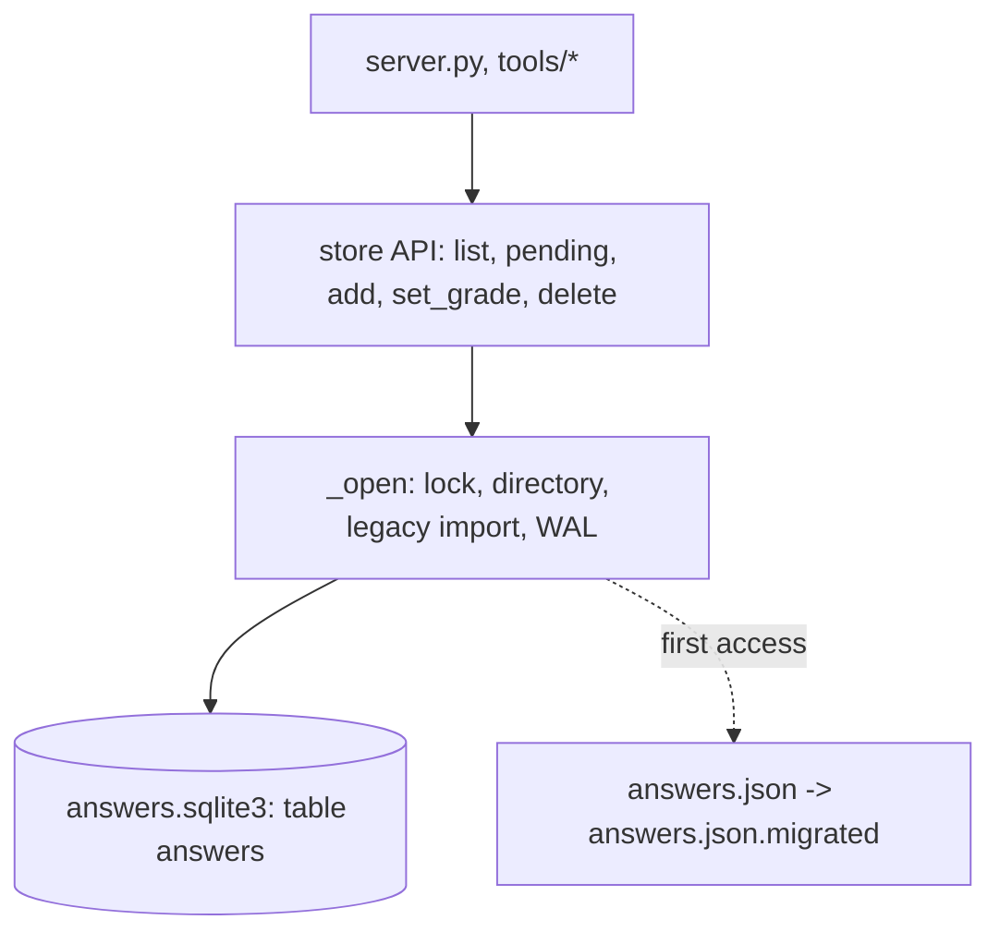

# Interview answer store

## Intent
Keep the user's interview answers and their grades on disk, one SQLite database per profile, behind the module
functions `server.py` and the `tools/` scripts already call. It exists so that the history no longer lives in a
single JSON file that is read and rewritten whole on every request, and so that answers saved by earlier versions
are carried over without the user doing anything.

## Context
`server.py` calls `list_answers`, `add_answer`, `set_grade` and `delete_answer` from its `/api/theory/*` handlers,
on a `ThreadingHTTPServer`, so calls arrive from several threads at once. `tools/theory_pending.py`,
`tools/grade_pending.py` and `tools/import_grades.py` call `pending` and `set_grade` from another process while the
server may be running. The page reads the records through `GET /api/theory/history` and `POST /api/theory/answer`,
and relies on the field names `id`, `qid`, `at`, `duration`, `answer`, `mode`, `grade` and `graded_at`.

The data directory comes from `backend.paths.data_dir()` (SP-PACKAGING): `store.DATA_DIR` is that directory and
`store.DATA` is `<DATA_DIR>/theory`, computed at import; tests monkeypatch `store.DATA`. Before this spec the file
was `<DATA>[/<profile>]/answers.json`, a JSON list rewritten atomically under a process-wide lock.

## Goals
- G1: the public API and the record shape are unchanged: `list_answers(profile)`, `pending(profile)`,
  `add_answer(qid, answer, duration, profile, mode)`, `set_grade(answer_id, grade, profile)`,
  `delete_answer(answer_id, profile)`, the constants `DATA_DIR` and `DATA`, and records with the eight fields above
  (`grade` a dict or `None`, `graded_at` an integer or `None`).
- G2: the records of a profile live in `<DATA>[/<profile>]/answers.sqlite3`, table `answers`, opened through the
  standard `sqlite3` module with one short-lived connection per call, `journal_mode=WAL`, `synchronous=NORMAL` and
  a 5 s busy timeout, so that the server threads and the tools never corrupt the file and a reader never blocks on
  a writer.
- G3: an `answers.json` found next to a profile's database is imported once, in one transaction, then renamed to
  `answers.json.migrated`; the import is idempotent and safe under concurrent first calls.
- G4: `list_answers` returns the records ordered by `at` ascending, insertion order breaking ties, as before.
- G5: the profile name is reduced to `[a-zA-Z0-9_-]` before being used as a directory name, and an empty name means
  the root `<DATA>` directory, as before.

## Non-Goals
- NG1: a schema migration framework: the schema is created with `IF NOT EXISTS` and is not versioned.
- NG2: pagination, filtering or counting endpoints: no caller needs them.
- NG3: deleting the legacy JSON file, or moving data between data directories.
- NG4: a connection pool or a long-lived connection: the server is local and single-user, and a cached connection
  would have to follow `DATA` when tests monkeypatch it and a deleted profile directory.

## Assumptions
- A1: `backend.paths.data_dir()` returns a writable directory (SP-PACKAGING); the store creates
  `theory[/<profile>]` under it on first write.
- A2: the Python interpreter's `sqlite3` module links SQLite 3.7 or later (WAL); every supported platform does.
- A3: a legacy `answers.json` is a JSON list of objects with at least `id`, `qid`, `at` and `answer`; `duration`,
  `mode`, `grade` and `graded_at` may be missing.

## Interface
Inputs:
- `profile`: `str | None` — the profile name; characters outside `[a-zA-Z0-9_-]` are removed, empty means the root.
- `qid`: `str` — the question id, as in `bank/theory/*.json`.
- `answer`: `str` — the candidate's text.
- `duration`: `float | None` — seconds spent, as sent by the page.
- `mode`: `str` — `online` or `offline`.
- `answer_id`: `str` — a record id, `YYYYMMDD-HHMMSS-<6 hex>`.
- `grade`: `dict[str, Any]` — the verdict of SP-GRADER or of `tools/import_grades.py`, stored as JSON text.

Outputs:
- `list_answers(profile) -> list[Answer]`: every record of the profile, ordered by `at` ascending.
- `pending(profile) -> list[Answer]`: the records of `list_answers` whose `grade` is falsy.
- `add_answer(...) -> Answer`: the record just written, `grade` and `graded_at` set to `None`.
- `set_grade(answer_id, grade, profile) -> Answer | None`: the updated record with `graded_at` stamped in
  milliseconds, or `None` when the id is unknown.
- `delete_answer(answer_id, profile) -> bool`: whether a record was removed.
- `DATA_DIR: str`, `DATA: str`: as before.

Table `answers` (resource `db:table:answers`): `id TEXT PRIMARY KEY`, `qid TEXT NOT NULL`, `at INTEGER NOT NULL`,
`duration NUMERIC`, `answer TEXT NOT NULL`, `mode TEXT NOT NULL`, `grade TEXT` (JSON or NULL), `graded_at INTEGER`;
index `answers_qid` on `qid`.

Errors:
- `sqlite3.OperationalError`: the database is locked for longer than the busy timeout or the directory is not
  writable; propagated to the caller.
- `json.JSONDecodeError`, `KeyError`, `TypeError`: the legacy `answers.json` is not a list of valid records; the
  import is rolled back, the file is left in place and the error propagates, so nothing is lost or hidden.

## Behavior
### Nominal
1. Every public function opens the profile's database under the module lock: it creates the directory, runs the
   legacy import when `answers.json` is present, connects with the busy timeout, sets `journal_mode=WAL` and
   `synchronous=NORMAL`, and creates the table and the index when they are missing. The lock is released before the
   query runs; SQLite serializes the writers.
2. `add_answer` inserts one row and returns the record it built; `set_grade` updates `grade` and `graded_at` in one
   transaction and returns the row read back; `delete_answer` deletes by id and reports the row count;
   `list_answers` selects every row ordered by `at` then `rowid`, parsing `grade` from JSON.
3. The connection is closed when the call returns, whatever the outcome. Closing the last connection makes SQLite
   checkpoint the WAL into the main file and remove the `-wal` and `-shm` side files, so every write ends durable
   on disk at the price of one fsync per call (milliseconds on an SSD, about 100 ms on a spinning disk); reads
   with nothing to checkpoint pay nothing. A single user answering interview questions never notices, and the
   module keeps no connection cache to invalidate.

### Edge cases
- Legacy import: `answers.json` present -> its records are inserted with `INSERT OR IGNORE` in one transaction
  (missing `duration`, `mode`, `grade` or `graded_at` default to `None`, `offline`, `None`, `None`), the file is
  renamed to `answers.json.migrated` (`answers.json.migrated.<n>` when that name is taken), and one line is logged
  through `logging.getLogger("sparring")` with the count and the paths.
- Two threads making the first call on a profile at once -> the second waits on the lock and finds no
  `answers.json`; the records are imported once.
- A database and a legacy file both present (an interrupted earlier migration) -> the import runs again; rows whose
  id is already stored are skipped.
- No file at all -> `list_answers` and `pending` return `[]` on a fresh, empty database.
- Profile `../../etc` -> directory `<DATA>/etc`; profile `a b/c` -> `<DATA>/abc`.

### Failure scenarios
- The database stays locked past the busy timeout -> `sqlite3.OperationalError` reaches the caller; the server
  answers 500 and logs the traceback.
- The legacy file is unreadable or malformed -> the import raises, the file keeps its name, the database stays as
  it was.
- A crash between the commit of the import and the rename -> the next call imports again, skipping the known ids,
  and renames the file.

## Architecture Impact
- Adds dependency: SP-STORE -> SP-PACKAGING (`backend/store.py` imports `backend.paths` for `data_dir()`; the
  edge existed as a frontier coupling noted in SP-PACKAGING and is now declared).
- New / changed coupling, cycles, or shared state: the table `answers` is reached only through this module;
  `server.py` and `tools/` (both frontier) call the module API and never the database.

## Diagram

## Acceptance Criteria
- [ ] AC1: add, list, grade and delete round trip through the database with the record shape above
  (`tests/test_store.py::test_add_answer_persists_a_record`, `tests/test_store.py::test_list_and_pending`,
  `tests/test_store.py::test_set_grade_stamps_the_record`, `tests/test_store.py::test_delete_answer`,
  `tests/test_store.py::test_missing_database_means_no_answers`,
  `tests/test_store.py::test_non_ascii_answer_round_trips`).
- [ ] AC2: `list_answers` orders by `at` ascending whatever the insertion order
  (`tests/test_store.py::test_answers_are_ordered_by_time`,
  `tests/test_store.py::test_equal_timestamps_keep_insertion_order`).
- [ ] AC3: the database is one file per profile, in WAL mode, with the `answers` table and the `qid` index
  (`tests/test_store.py::test_profiles_are_isolated`, `tests/test_store.py::test_database_schema_and_journal_mode`).
- [ ] AC4: a legacy `answers.json` with a graded and an ungraded record is imported on the first access, renamed to
  `.migrated`, logged once, and a second import skips the known ids
  (`tests/test_store.py::test_legacy_json_is_imported_then_renamed`,
  `tests/test_store.py::test_migration_is_idempotent`,
  `tests/test_store.py::test_migration_keeps_an_earlier_migrated_file`); a malformed file or a record without an
  id rolls the import back and keeps the file (`tests/test_store.py::test_malformed_legacy_file_is_left_in_place`,
  `tests/test_store.py::test_legacy_record_without_id_rolls_back_and_keeps_the_file`).
- [ ] AC5: concurrent `add_answer` calls from threads all land, with distinct ids
  (`tests/test_store.py::test_concurrent_adds_from_threads`), and a writer waits for a database another
  connection holds locked (`tests/test_store.py::test_add_answer_waits_for_a_locked_database`).
- [ ] AC6: profile names are stripped to `[a-zA-Z0-9_-]` and cannot leave the data directory
  (`tests/test_store.py::test_profile_names_cannot_escape_the_data_directory`).
- [ ] AC7: `DATA` and `DATA_DIR` keep following `SPARRING_DATA_DIR` and the clone layout
  (`tests/test_store.py::test_data_dir_override_moves_the_answers`,
  `tests/test_store.py::test_default_data_dir_is_under_the_clone`), and the HTTP API is unchanged
  (`tests/test_server.py`).
- [ ] AC8: manual, recorded in the pull request: a server started on a scratch `SPARRING_DATA_DIR` holding a legacy
  `theory/answers.json` with two records serves both on `GET /api/theory/history`, accepts an offline
  `POST /api/theory/answer`, and leaves `answers.sqlite3` and `answers.json.migrated` behind.

## Open Questions
