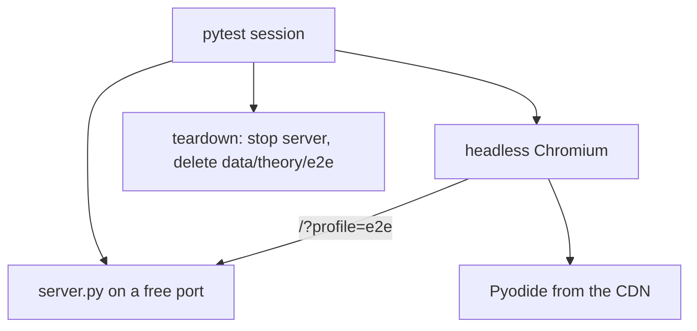

# JavaScript lint and browser end-to-end tests

## Intent
Give the web page the two checks it lacked: a linter for `app/js` and a browser-driven test of the five flows a
user relies on (page boot, exercise check and Stop, quiz, interview answer, theme). It exists so that a change to the page
is caught by CI instead of by the next person opening the app.

## Context
The page is a set of classic scripts (`theme-init.js`, `common.js`, `py-client.js`, `app.js`, `qcm.js`,
`theory.js`) that share state through `window`, a Web Worker (`py-worker.js`, SP-PY-RUNTIME) and two CDN bundles
(CodeMirror, Pyodide). The Python test suite (`tests/`) covers the server and
the harness but never opens a browser. This component adds `package.json` + `eslint.config.js` (ESLint 9 flat
config, run with `npm run lint`) and `tests/e2e/` (pytest + Playwright, headless Chromium, a real `server.py` on a
free port). It tests the app from outside: it imports nothing from it; its one dependency is the `SPARRING_CONFIG`
contract of SP-CONFIG, through which the server under test gets its port and the offline grader. Code-only:
`resources: []`.

## Goals
- G1: `npm run lint` passes on `app/js` with `@eslint/js` recommended plus `eqeqeq`, `no-var` and `prefer-const`.
- G2: every scenario of the Acceptance Criteria runs headless against a server started by the tests, with the
  `e2e` profile, and leaves no process and no data behind.
- G3: `python -m pytest -q` keeps passing and fast on every machine: the e2e suite is opt-in (`addopts = "-m 'not
  e2e'"` in `pyproject.toml`, overridden by an explicit `-m e2e`) and its modules skip without Playwright.
- G4: CI runs the lint and the e2e suite in their own jobs; the `unit` matrix job runs a plain `python -m pytest -q`
  and the required check `test` only aggregates its legs.

## Non-Goals
- NG1: changing the behavior of the page beyond what the lint rules require.
- NG2: testing online grading (the server under test reads a temporary settings file with `grader.backend =
  offline` and no `ANTHROPIC_*` or `CLAUDE_*` variable; the interview test asserts the offline status before it
  submits).
- NG3: visual regression or cross-browser coverage: Chromium only.

## Assumptions
- A1: the CDNs (jsdelivr for Pyodide, cdnjs for CodeMirror, Google Fonts) are reachable from the test runner.
- A2: `server.py` serves `app/` and the `/api/*` endpoints from the repository root on the port of the settings file
  named by `SPARRING_CONFIG` (SP-CONFIG), and `?profile=e2e` isolates localStorage (`tt[e2e].`) and
  `data/theory/e2e/`.
- A3: `app.js` keeps exposing its state on `window.tt` (`tt.current`, `tt.editor`) and `common.js` on `window.TT`.

## Interface
Inputs:
- `npm run lint`: lints `app/js/**/*.js` as classic scripts with browser globals plus `CodeMirror` and `loadPyodide`;
  `py-worker.js` gets the worker globals instead.
- `python -m pytest -q -m e2e tests/e2e`: runs the browser suite, which a plain `python -m pytest -q` excludes;
  needs the `e2e` extra and a Chromium build (`python -m playwright install chromium`).

Outputs:
- Lint: exit code 0 and no output when clean; one line per violation otherwise.
- Tests: standard pytest report; the server's warnings (`SPARRING_LOG_LEVEL=WARNING`) go to the captured stderr.

Errors:
- A server that does not answer `/api/health` within 30 s fails the session fixture with the exit code or a timeout.
- A page whose Pyodide load does not reach `Python ready` within 120 s fails the `ready_page` fixture.

## Behavior
### Nominal
1. `base_url` (session) removes `data/theory/e2e/`, writes a temporary settings file with `server.port` set to a
   free port and `grader.backend = offline`, starts `server.py` with cwd at the root, `SPARRING_CONFIG` pointing at
   that file, `SPARRING_LOG_LEVEL=WARNING` and no `ANTHROPIC_*` or `CLAUDE_*` variable, then waits for
   `/api/health`.
2. `ready_page` (session) opens `/?profile=e2e` once, records console errors and failed requests, waits for
   `#py-status` to read `Python ready`; the boot and exercise tests share it so Pyodide loads once per session.
3. The quiz, interview and theme tests use a fresh page each.
4. Teardown stops the server (terminate, then kill after 10 s) and removes `data/theory/e2e/`.

### Edge cases
- Playwright not installed -> `pytest.importorskip("playwright.sync_api")` skips every module in `tests/e2e/`.
- No SQL exercise in the bank -> the SQL test skips.
- The bank's first exercise is random (the list is shuffled) -> the tests read the current id from `window.tt`
  and fetch its `solution` from `/api/exercises` through the page's request context.

### Failure scenarios
- A console error or a failed request during boot -> listed in the assertion message of the boot test.
- A solution failing one of its own tests -> the verdict is not `OK n/n` and the failing `details.result` count is
  reported.

## Architecture Impact
- Adds dependency: SP-WEB-QA -> SP-CONFIG (the e2e server is configured through a temporary settings file named by
  `SPARRING_CONFIG`, so the user's `config.json` is never read by the tests).
- New / changed coupling, cycles, or shared state: none beyond that variable; the tests reach the app through HTTP
  and the DOM only.

## Diagram

## Acceptance Criteria
- [ ] AC1: `npm run lint` (ESLint flat config, recommended plus `eqeqeq`, `no-var`, `prefer-const`) reports no
  violation on `app/js`; the CI job `js` runs `npm ci && npm run lint`.
- [ ] AC2: the page boots with no console error and no failed request
  (`tests/e2e/test_page.py::test_page_loads_without_console_errors_or_failed_requests`).
- [ ] AC3: the first Python exercise's own solution, set in the CodeMirror editor, passes every test after Check
  (`tests/e2e/test_exercises.py::test_python_solution_passes_every_test`), and the same for a SQL exercise
  (`tests/e2e/test_exercises.py::test_sql_solution_passes_every_test`).
- [ ] AC4: a quiz question answered with the keyboard shows the explanation
  (`tests/e2e/test_quiz.py::test_answer_with_the_keyboard_shows_the_explanation`).
- [ ] AC5: an interview answer submitted in offline mode appears in the history as pending
  (`tests/e2e/test_interview.py::test_offline_answer_is_saved_in_the_history`).
- [ ] AC6: the theme toggle flips `data-theme` on the root element and back
  (`tests/e2e/test_page.py::test_theme_toggle_flips_the_root_attribute`).
- [ ] AC7: `python -m pytest -q` deselects `tests/e2e/` through `addopts` and passes; without the `e2e` extra,
  `python -m pytest -q -m e2e tests/e2e` collects the modules as skipped.
- [ ] AC8: the page is cross-origin isolated, Stop interrupts `while True: pass` with an `Execution interrupted`
  message, and the next Run prints its output (`tests/e2e/test_exercises.py::test_stop_interrupts_an_infinite_loop_and_python_keeps_working`),
  which automates AC4 to AC6 of SP-PY-RUNTIME.

## Open Questions
